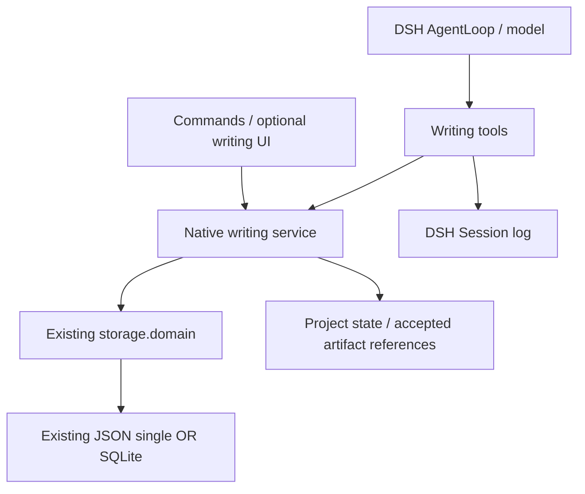

# Story writing in DSH: feasibility and technical validation

## Summary

The native DSH route is feasible for the verified technical slice. Real DSH profiles loaded local plugins, executed concurrent tools, persisted accepted settings through the shipped JSON domain storage, and read the same result in a second process. JSON and SQLite also passed isolated storage and writing-state probes. These results establish host integration and state handling, not migrated writing algorithms or real-model quality.

## Table of Contents

- [Scope and decisions](#scope)
- [Migration mapping](#mapping)
- [Executed results](#results)
- [Reproduction](#reproduction)
- [Limits and remaining work](#limits)
- [Dev Note](#dev-note)

<a id="scope"></a>

## Scope and decisions

The user requires independence from the Story backend and authorizes technical validation. DSH is authoritative for the framework, model loop, tool scheduling and persistence. Parallel tool calls are allowed. Story’s required/named selection, one-tool-per-round rule, LangGraph, PostgreSQL lane system, Arq, MinIO and credit-account implementation are not compatibility requirements for the migration.

The retained business scope is settings → book outline → chapter outline → body, with research, review, targeted repair, continuity and readable applied outputs. The native implementation can reorganize these behaviors through DSH tools and services. The user has not requested image/video generation, payment sales, historical-book import or a complete frontend clone.

Evidence date: 2026-09-10. DSH working tree: master `aa8262ec09`; Story: master `b41c8003` with pre-existing changes. Probes ran locally on macOS with Node `24.18.0` and installed Vitest `4.1.8`. CodeGraph was unavailable; source inspection used current files. No Story module, server or database was imported or contacted by the probes.

<a id="mapping"></a>

## Migration mapping

Story’s writing_pipeline contains 86 Python files and 141,491 physical lines, with 53 files explicitly importing application modules outside that directory. This is a subsystem inventory, not the amount to port. The source informs domain behavior; DSH supplies its own execution mechanisms.

| Business or mechanism | Source evidence | DSH direction |
| --- | --- | --- |
| Settings | [Settings graph](../../../story_weaver/app/services/writing_pipeline/settings_graph.py), line 2072 onward: dimensions, dependency layers, review and repair | Native tools/services and prompts; the probe only represents candidate/accept/apply state |
| Outline and chapter outline | [Outline graph](../../../story_weaver/app/services/writing_pipeline/outline_graph.py), line 4070 onward; [chapter outline graph](../../../story_weaver/app/services/writing_pipeline/chapter_outline_graph.py), line 5470 onward | Retain research, evidence, word budgets, obligations and continuity; implement through DSH |
| Body | [Body runner](../../../story_weaver/app/services/writing_pipeline/body_graph_runner.py), lines 200–295: core output then lifecycle/final continuity | Text completion alone is not business completion; real review and continuity remain to migrate |
| Artifact identity | [ArtifactRef](../../../story_weaver/app/services/writing_pipeline/contracts.py), lines 70–113 | Use DSH-owned identities, revisions and bounded artifact reads; no requirement to preserve S3 URIs or Python serialization |
| Runtime and tools | [DSH architecture](../../../deepseek-harness/docs/architecture.md); [tool execution](../../../deepseek-harness/packages/core/tools/src/index.ts) | Use actual AgentLoop/ToolRuntime, scope registrations through effects, and permit safe concurrency |
| Persistence | [Domain update](../../../deepseek-harness/packages/storage/storage-domain/src/domain.ts), lines 80–89, 332–350 | Keep state that commits together in one project aggregate, transform it with the existing queued update, select JSON or SQLite |
| Model parameters | [Story wire request](../../../story_weaver/app/services/qianwen/client.py), lines 698–721; [DSH request fields](../../../deepseek-harness/packages/llm/llm/src/types.ts) | Adopt DSH semantics; absence of Story-specific tool-choice controls is not a migration blocker |
| UI | [Client plugin example](../../../deepseek-harness/packages/client/ui-workflow-run/src/client/index.ts) | Client plugins can supply stage cards and editors; no UI migration was performed |

<a id="results"></a>

## Executed results

These are separate executed checks, not one combined suite. All model outputs, creative text and review decisions were deterministic local fixtures. Every underlying tool runtime and storage provider under test was real.

| Check | Result | Observation |
| --- | --- | --- |
| Storage writer and independent reader | 3/3 + 3/3 | JSON single, JSON per-record and SQLite preserve stage/artifacts/head/revision in distinct processes. Sixteen pending updates produce revisions 2–17 without loss; rejected pure transforms do not commit, and a later write succeeds. |
| Damaged/schema-invalid data | 5/5 | All three reject schema-invalid records. Truncated JSON single rejects; truncated JSON per-record opens with the affected project absent and the damaged file preserved. |
| Real AgentLoop scheduling and logs | 3/3 | Barrier proves two reads overlap. Exclusive apply is ordered read → apply → read. Cancellation drains both readers with no queued write executed. JSONL reopen derives the identical six-message history. |
| Native writing state over JSON/SQLite | 8/8 | Four synthetic stage outputs; accepted-before-applied persistence; repeated begin/accept/apply; conflicting completion rejection; same-project creation exclusion; competing apply rejection; downstream head invalidation; graceful reopen and explicit interrupted-task resume. |
| Actual headless profile with plugin patch | Passed | Real DSH source CLI loads the local plugin, runs two concurrent novel reads, records two tool calls/results and exits 0 without timeout. |
| Actual profile → writing service → JSON → second profile | Passed | First process produces accepted settings with no applied head, applies revision 1, then reads it. Second process in the same isolated DSH home reads the identical revision, artifact hash, text and task. Both exit 0 without timeout. |

The integrated profile uses the base bundle’s existing storage-json and storageDomain, not a custom database. Its first Session contains prepare/apply/read tool results; its second Session contains a fresh read. The framework therefore carries model tool calls into the native writing service and persists their outcome across process lifetimes.

Strict diagnostics for the three writing probe entry files are zero after the final edit. This was a scoped TypeScript API check: applying the same root options across the imported graph also reported 70 diagnostics in vendored source, so it is not a passing whole-repository or dependency-graph typecheck. No vendored files were changed.

<a id="reproduction"></a>

## Reproduction

Run from the DSH repository root using installed dependencies. The following source probes are local ignored files under `.codex/spikes/story-writing-dsh/`; they are not shipped packages. No command installs dependencies or calls a real model.

```sh
node .codex/spikes/story-writing-dsh/storage/run.mjs
node node_modules/vitest/vitest.mjs run --config .codex/spikes/story-writing-dsh/storage/corruption.vitest.config.ts --reporter verbose
pnpm exec vitest run --config .codex/spikes/story-writing-dsh/host/vitest.config.ts
pnpm exec vitest run --config .codex/spikes/story-writing-dsh/writing/vitest.config.ts
python3 .codex/spikes/story-writing-dsh/host/run-profile.py
python3 .codex/spikes/story-writing-dsh/host/run-integration.py
```

The Python files above are test launchers, not the writing engine. They invoke the real DSH source CLI with a headless profile, isolate home/workspace/environment, wait for process exit and retain proof JSON/session logs. The integrated launcher adds a source-only zod alias to the already-installed storage-domain dependency because `.codex` is not a workspace package. Published-package dependency resolution remains unverified.

Local evidence includes `storage/` writer/reader and corruption specs; `host/read-overlap.proof.json`, `write-barrier.proof.json`, `cancellation.proof.json`, `profile.proof.json`, `integration.proof.json` and their Session logs; and `writing/` state implementation/specs. Temporary data homes were removed after verification. The session checkpoint owns command results and process status.

<a id="limits"></a>

## Limits and remaining work

Concurrency has two levels. DSH runs tools marked concurrency-safe in parallel and orders exclusive tools. The existing domain update then serializes record transforms. This supports one host/facility owning a novel while reads or independent computations overlap; it does not establish correctness for several DSH processes simultaneously writing the same medium.

For authoritative writing data, JSON single and SQLite are the verified initial candidates. JSON per-record’s truncated-document-as-missing behavior was observed directly. Every variant still replaces the complete changed project aggregate; full novels and large artifact histories require a measured layout, bounded reads and publication/recovery rules before production use.

The recovery evidence covers orderly shutdown and sequential process restart, plus cooperative Agent cancellation. It does not cover power loss, process kill between a model request and receipt, cross-process writers, complete artifact access grants, multi-chapter continuity or model-call charging. Fixed text and a boolean review fixture do not prove creative quality or Story’s actual review/repair algorithm.

No production package, UI, model/provider configuration, dependency, Story file or shared DSH runtime was modified. No commit, push, deployment or real-model call occurred. Confidence is high for the executed framework/storage slice and unestablished for full migration quality, distribution and scale.

<a id="dev-note"></a>

## Dev Note

DSH-first native TypeScript migration is the current technical direction. The following packaging and delivery sequence remains a proposal; the technical probes do not authorize a production implementation or distribution action.

One opt-in bundle can assemble a writing Service Definition, local Service Provider and tool/command Consumers. Roles can remain together until separate evolution warrants packages. Use DSH AgentLoop for model work and its ordinary tool-result logging, with writing-specific state recorded through storage.domain. The business service owns project access, revisions and applying accepted outputs.



Start by migrating actual settings inputs, dimension definitions, generation prompts and review/repair behavior into this verified path. Then add outline, chapter outline, body and required continuity in vertical slices. Preserve the intended business outcomes while using DSH concurrency, cancellation and model semantics. Add a real-model acceptance run only after its scope and cost are authorized.

Before release, replace inline synthetic artifacts with measured long-text storage, complete project/task isolation and crash recovery, declare dependencies in an actual installable bundle, and validate the chosen Client UI. The present source-profile proof does not replace an installation test of that future package.
