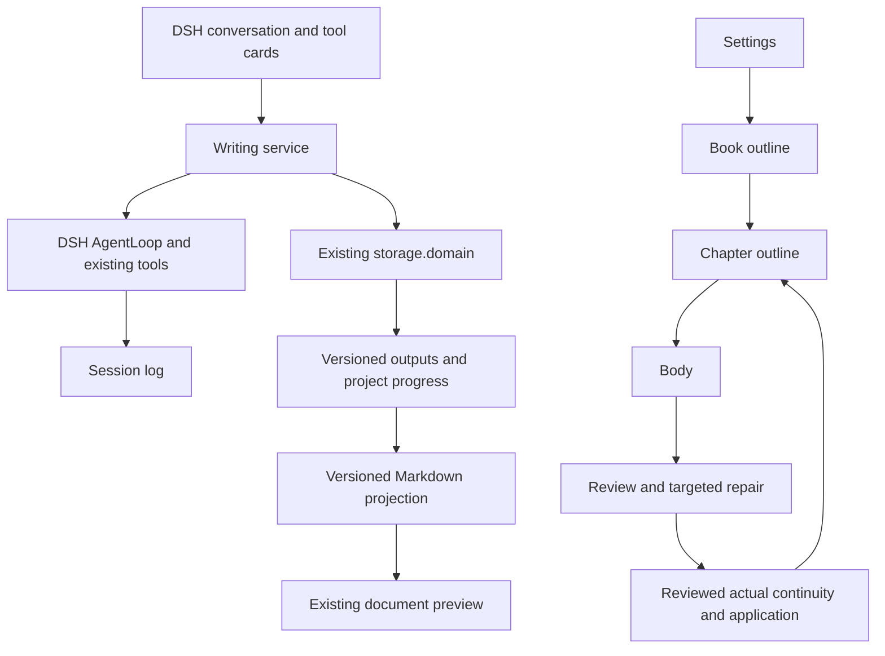

# Story writing plugin specification

## Summary

The requested plugin takes creative requirements through settings, book outline, chapter outline, body, review, targeted repair and chapter application inside DSH. Users work through existing conversations, tool cards and document preview. The first acceptance run produces three consecutive chapters of 3,000–5,000 words each under the Chinese counting rule defined below. This is a specification for implementation, not a claim of delivered writing capability.

## Table of Contents

- [Requirements](#requirements)
- [User stories](#stories)
- [Acceptance](#acceptance)
- [Repository and installation](#repository)
- [Scope limits](#scope-limits)
- [Dev Note](#dev-note)

## Requirements

The [domain glossary](CONTEXT.md) defines candidates, applied versions and continuity. The [technical validation](../../research/story-writing-plugin-research.md) establishes the existing DSH integration and persistence evidence; its limitations remain applicable until production validation covers them.

DSH owns the framework, agent execution, tool scheduling, model configuration and persistence. Writing runs independently of the Story backend. Native TypeScript implementations retain the writing behavior, prompts and domain constraints that serve these requirements. Story's execution framework and single-tool restriction are not migration requirements; safe concurrent tools are allowed.

The normal path advances automatically through required stages and successive chapters. Review and repair operate before application, without asking the user to approve every stage. Only a formally applied chapter with reviewed continuity allows the next chapter to proceed.

Proactive presentation shows complete documents for only four artifact kinds: assembled settings (`settings`), `book-outline`, `chapter-outline` and `body`. Individual settings dimensions, research, reviews, continuity and rejected raw output remain persisted for audits and explicit reads; they are not automatically presented. A full document may still be a candidate and must not imply application. Eligible repair versions retain their identities, and existing historical links remain readable.

The user accepts completion with remaining advisory issues. Chapter length violations, omitted required chapter-outline events, settings or character contradictions, and cross-chapter continuity conflicts block completion. Reviews must identify the affected output, issue location and supporting evidence; an unsubstantiated approval flag is insufficient.

When the user changes upstream content, historical versions remain readable and affected downstream outputs are marked as needing update. The plugin shows the affected range and reasons. Only an explicit request to update downstream content starts that repair run; it then proceeds automatically within the requested range.

## User stories

The first release covers these writing activities through existing DSH interfaces.

1. As an author, I can enable the plugin in DSH and create a novel without running Story services.
2. As an author, I can select a novel, provide creative requirements and find its work again after a restart.
3. As an author, I can ask for researched settings whose dimensions respect their dependencies and my requirements.
4. As an author, I can obtain a reviewed book outline with chapter purposes, required events, character development and a planned ending.
5. As an author, I can obtain a chapter outline based on current settings, book outline and actual preceding events.
6. As an author, I can request a chapter range and receive complete prose within the configured chapter length range.
7. As an author, I can explicitly inspect specific review problems, automatic repairs and remaining advisory issues.
8. As an author, I can continue writing without planned events being mistaken for facts that have already occurred.
9. As an author, I automatically receive complete settings collections, book outlines, chapter outlines and bodies in the existing tool-card preview, and can explicitly read retained internal evidence.
10. As an author, I can change upstream content, inspect the affected outputs and explicitly request their update while keeping the originals.
11. As an author, I can stop work, inspect what was saved and request continuation from durable progress.
12. As an author, I can distinguish a completed chapter from a failed, interrupted or still-unreviewed candidate.

## Acceptance

The first product acceptance scenario starts from one creative brief and produces three consecutive applied chapters, each containing 3,000–5,000 counted words. This sample does not impose a three-chapter product limit. The exact creative brief and any paid execution budget are fixed before the live run.

| Requirement | Evidence required for acceptance |
| --- | --- |
| Independent operation | The built plugin runs through DSH profiles with Story services unavailable and no imports from the Story checkout. |
| Complete automatic path | One writing request produces applied settings, book outline, each chapter outline, body and reviewed continuity without per-stage user approval. |
| Chapter length | One program-owned counter measures the final body after every repair; 2,999 and 5,001 fail, while 3,000 and 5,000 pass this check. |
| Substantive review | Required-event coverage and settings, character and continuity checks produce evidence tied to the exact reviewed version. Unresolved blocking issues prevent application. |
| Advisory completion | A chapter containing only non-blocking style suggestions can apply and trigger the next chapter. |
| Actual continuity | Chapter N uses the applied facts after N−1. Plans remain separate; repeated application cannot duplicate events or obligation completion. |
| Durable visible output | Automatically present only complete `settings`, `book-outline`, `chapter-outline` and `body` versions. A fresh three-chapter run without repairs presents eight documents. Read each exact version to EOF; retain internal review/evidence records for explicit reads and preserve historical links after restart. |
| Upstream changes | Existing versions remain readable; dependent outputs show the changed inputs. No downstream writing occurs until an explicit update request. |
| Update run | The requested affected range is reviewed and repaired in dependency order, with history retained and the same completion criteria enforced. |
| Honest failure | Invalid outputs, failed storage, cancelled work and exhausted repair attempts cannot appear as completed chapters. |

Here, error-free completion means that mechanical checks pass and the required reviews leave no detected blocking issues. It is not a guarantee that a model can detect every possible literary defect. Live acceptance combines saved automated evidence with human reading of the three chapters.

## Repository and installation

The plugin owns a separate private GitHub repository, hldz-top/dsh-story, and an independent local project. Its project-level development harness governs plugin code, prompts, tests, documentation and releases. DSH remains the integration host, and Story remains a source of business behavior. Plugin implementation does not live inside either application's repository.

Installation uses one CLI command containing the plugin address through the existing dsh plugin entry. Browser, OS-protocol and Desktop installation entry changes are outside this scope. The installed result must be a built, versioned DSH composition bundle, usable without the plugin or Story source checkouts. Private-source and private-artifact access must be handled without credentials in a URL. Installation success requires the expected version to be active in the selected DSH deployment and a real writing operation to work after reload.

## Scope limits

The first release uses existing DSH conversations, tool cards and document preview. A separate novel workbench, Story frontend clone, historical Story database import, commercial billing, image/video production and publishing to external platforms are outside this scope. Markdown preview is required; additional export formats are not required for this acceptance run.

Concurrent reads, independent research and separate novels are within scope. Simultaneous writing to the same novel from multiple DSH host processes is outside the initial supported deployment. Large-book scale beyond the acceptance sample needs additional measured evidence before a performance claim.

## Dev Note

The following implementation and test design is proposed for approval with the task breakdown. It does not describe shipped APIs or authorize installation, paid calls, publication or Git operations.

### Components and public tests

The independent repository produces an opt-in composition bundle that assembles one writing capability: its Cordis Service Definition, local Service Provider and tool Consumers. Keep roles together unless their evolution requires separate packages. A thin Client contribution renders writing status and the four eligible document kinds through existing tool-card extension points. Internal review outcomes remain available through explicit queries and reads. Research, review and repair remain internal writing behavior rather than separate generic platforms.

The main TDD interface is the writing service's public commands and queries: create/select, write a target, read progress or artifacts, revise upstream content, update an affected range, stop and resume. Tests assert persisted observable results, not private graph nodes. Parser/tool schemas and exported TypeScript types own exact fields when introduced; their corresponding package documentation must cover validation, side effects and readback.

An additional integration test uses the real DSH AgentLoop, ToolRuntime and Session persistence, replacing only the model adapter with complete deterministic fixtures. The shipped-profile test and browser flow cover composition and presentation. These are complementary checks of one capability, not separate production execution frameworks.

### State and storage

Use existing storage.domain with JSON single or SQLite. The project owns current version references, input dependencies, run progress and update markers. Store immutable long-text versions separately from frequently changed progress; publish references only after their content is durable. One queued project update commits the adopted chapter reference and continuity reference together. No multi-record transaction is assumed.

The first implementation measures this layout on the acceptance sample and its retained revisions. The service checks project ownership and expected input versions when applying work. Same-host concurrent agents cannot overwrite a newer result; an Agent's exclusive tool scheduling alone is insufficient protection.

Document preview reads Session-accessible files rather than domain records. Versioned Markdown files are rebuildable projections of authoritative stored outputs, with scoped access and stable version paths. Missing projections can be recreated; a user edit is submitted as a new source version through the writing service. Direct edits to a preview file do not silently alter authoritative history.

Model-visible creative requirements, retrieved evidence, prompts and tool results must be reconstructable through DSH Session logging. Stage execution uses the configured DSH model route and existing AgentLoop mechanisms; it does not hard-code or switch model providers. Long text is read through bounded artifact ranges instead of repeatedly injecting a whole novel.

### Review, application and recovery

Settings generation respects dimension dependencies. Research records its questions, source provenance and evidence; a stage with no external research need records that decision. Required research failure remains a failure, not an empty successful evidence set. Book and chapter outlines preserve explicit obligations, evidence links and versioned inputs.

The proposed counting rule retains Story's text counter: each matched CJK character counts once, and each Latin-letter/digit word with internal apostrophes or hyphens counts once. Whitespace and punctuation do not count. Count the assembled body, excluding titles and reports; stage plans and per-scene estimates do not replace the chapter-total check. The range is configurable and the acceptance profile sets 3,000–5,000. Existing Story advisory-length prompts must be rewritten to match this requirement.

Reviews identify blocking issues and advisory issues separately. Targeted repair rechecks the resulting full chapter, its word count and affected facts. Repair count, research budget, read sizes and model execution limits are finite validated configuration values, fixed before a run. Exhaustion saves the current candidate and blocking reasons, then stops automatic progression.

Final continuity is derived from the preceding applied continuity plus evidence in the actual reviewed body. Planned chapter events remain separate evidence. Body, reviewed continuity and obligation outcomes apply together under a version check; duplicate completion requests have no additional effect. Upstream edits retain historical references and mark affected outputs instead of erasing their heads.

Stopping prevents new stage/model work, propagates cancellation and waits for owned work to settle. Restart recovers stored progress without automatically resending a model call whose outcome is unknown. Explicit resume reuses durable completed outputs and reruns only work that is necessary and authorized. Durable results can be applied idempotently; an in-memory idle signal is not proof of a writing run's success.

### Validation and delivery

Each vertical task includes its public behavior tests, real storage readback, model-visible Session snapshot where applicable, tool-card presentation, versioned preview and English-only package documentation. Failure tests cover malformed model output, wrong input versions, repeat application, chapter-length boundaries, unfulfilled obligations and isolated novels. The package decision includes an Agent Note when production implementation begins.

Run-level validation adds cancellation during parallel work and process termination before/after durable results and application. It checks absence of late commits, clear interrupted status, reusable durable artifacts and explicit handling of uncertain model calls. Corruption checks and bounded text reads must fail visibly rather than silently omit a novel.

Distribution acceptance loads built artifacts through the supported DSH profile path without source aliases or Story dependencies. After feature implementation is complete, browser validation follows create → write → open the four eligible document kinds → explicitly inspect review evidence → change upstream → inspect impact → request update → restart and read again. A fresh three-chapter run without repairs must produce eight automatic documents and no new automatic internal-result or rejected-output entries. Fixtures establish deterministic behavior; a separately authorized real-model run establishes the three-chapter writing evidence. Product completion requires both forms of evidence and final human acceptance.

### CLI installation design

The installation entry is the existing DSH CLI, using a fixed-version plugin address and an explicit target profile. Read credentials for the private repository must be configured before installation and must not appear in the address or logs. The distribution contains built runtime files and dsh.bundle.patch; users do not run Story services or build the plugin from source. A real command is supplied only after the selected protocol, version and authentication combination passes private CLI installation validation. This validation design does not authorize Git publication, installation into the user environment or paid calls.

The [private CLI distribution study](../../research/private-cli-install-research.md) recommends a Git SSH address pinned to the full SHA of a prebuilt release commit. This is a design awaiting real installation validation, not a published installation command.
